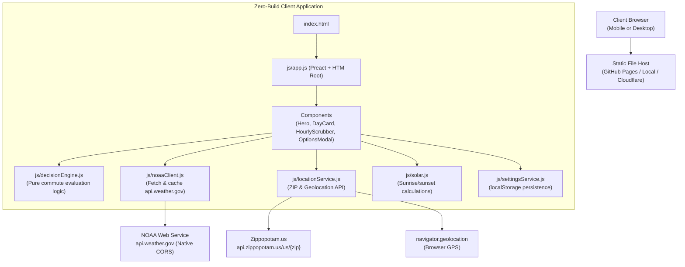
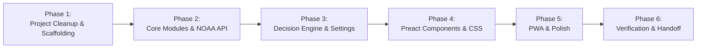

# Commuter Weather: Zero-Build Modernization Plan & Specification

## 1. Executive Summary & Approved Decisions

### 1.1 Goals
Modernize the **Commuter Weather** application into a fast, responsive, mobile-and-desktop web application that:
1. Replaces defunct CORS proxies with the official **NOAA REST Web API** (`api.weather.gov`), which provides native CORS support.
2. Adopts a **Zero-Build architecture** (Preact + HTM via native ES Modules) that requires **no Node.js, no npm dependencies, and no build pipeline**, ensuring permanent zero-maintenance longevity.
3. Supports dual location input: **US ZIP code lookup** and an instant **"Use Current Location" (browser GPS)** button.
4. Keeps the UI clean and uncluttered by displaying **concise reason chips** (e.g., `Wind 28mph`, `Rain 60%`) rather than heavy text blocks.
5. Standardizes commute windows for a regular work-week schedule (Monday–Friday morning and afternoon commutes).
6. Transitions options storage from legacy cookies to modern browser `localStorage`.
7. Cleans up obsolete Google App Engine Java 8 artifacts, leaving a clean, lightweight static repository.

---

## 2. Architecture & Tech Stack



### 2.1 The Zero-Build Approach
* **Runtime**: Native Browser ES Modules (`<script type="module" src="js/app.js">`).
* **UI Framework**: **Preact** (~4.5 KB) paired with **HTM** (~0.6 KB).
  * Provides a familiar React-like developer experience (`useState`, `useEffect`, declarative component rendering) with zero build overhead.
  * Uses standard tagged template literals (`html\`<div class="card">\${title}</div>\``) natively supported by all modern browsers.
  * Can be loaded from CDNs (`esm.sh`) and optionally cached/vendored locally for complete offline autonomy.
* **Styling**: Modern, responsive CSS with CSS custom properties (variables), CSS Grid, Flexbox, and media queries for mobile/desktop layouts and automatic dark mode.
* **Zero Machine Footprint**: 0 MB `node_modules`, no Node.js installation required, instant local development using any static file server (including `python -m http.server 8000`).

---

## 3. NOAA RESTful Web API & Location Service

### 3.1 Direct NOAA API Workflow
The modern NOAA API (`api.weather.gov`) requires no proxies and returns GeoJSON with standard CORS headers:

1. **Resolve Grid Coordinates**:
   `GET https://api.weather.gov/points/{latitude},{longitude}`
   * Returns office code, grid X/Y coordinates, local timezone, city/state, and forecast links.
2. **Retrieve Hourly Forecast (Commute Evaluation)**:
   `GET https://api.weather.gov/gridpoints/{office}/{gridX},{gridY}/forecast/hourly`
   * Returns up to 156 hourly forecast periods with temperature, precipitation probability, wind speed, wind gust, and sky condition.
3. **Retrieve 12-Hour Daily Summary**:
   `GET https://api.weather.gov/gridpoints/{office}/{gridX},{gridY}/forecast`
   * Returns daily narrative forecast ("Today", "Tonight", "Monday", etc.) with high/low temperatures.
4. **Active Weather Alerts**:
   `GET https://api.weather.gov/alerts/active?point={latitude},{longitude}`
   * Replaces legacy scraped hazards with official NWS advisories, watches, and warnings.

### 3.2 Dual Location Resolution
* **US ZIP Code**: Queried via `https://api.zippopotam.us/us/{zip}` (fast, free, CORS-enabled, returns latitude, longitude, city, and state).
* **Current GPS Location**: Uses standard `navigator.geolocation.getCurrentPosition()`.
* **Caching**: The resolved location and NOAA grid endpoint URLs are saved in `localStorage` to eliminate redundant grid lookups on subsequent page loads.

---

## 4. Commute Decision Engine & Clean Reason Chips

### 4.1 Evaluation Criteria & Thresholds
| Metric | Default Warn (Caution) | Default Drive | Condition |
|---|---|---|---|
| **Min Temperature** | 40°F | 38°F | `temp < threshold` |
| **Max Temperature** | 95°F | 100°F | `temp > threshold` |
| **Precipitation Chance** | 20% | 50% | `pop > threshold` |
| **Wind Speed** | 20 mph | 25 mph | `speed > threshold` |
| **Wind Gust Speed** | 20 mph | 25 mph | `gust > threshold` |
| **Time Before Sunrise** | 75 min | 90 min | Morning commute starts before sunrise |
| **Time After Sunset** | 75 min | 90 min | Afternoon commute ends after sunset |

### 4.2 Work-Week Commute Windows
* Default Morning Window: **05:30 – 06:30** (configurable, toggleable On/Off).
* Default Afternoon Window: **15:00 – 16:00** (configurable, toggleable On/Off).
* Applied across the standard work-week (Monday through Friday). For weekends or non-commute days, the app can display the general daily outdoor rating.

### 4.3 Uncluttered Reason Badges (UI Simplicity)
To prevent visual clutter, warning details will not use lengthy paragraphs. Instead, they will render as **compact, muted pills/chips** directly beside the rating:
* *Examples*:
  * `[Rain 60%]`
  * `[Gusts 28mph]`
  * `[Cold 37°F]`
  * `[Darkness +80m]`
* On daily summaries, only the dominant trigger(s) appear as small chips. Full hourly details remain neatly tucked inside the collapsible/expandable period card.

---

## 5. Responsive UI Layout (Mobile & Desktop)

### 5.1 Mobile Layout
* **Header**: App title, quick location indicator, last updated time, Refresh icon, and Settings gear icon.
* **Hero Banner**: High-level status of the immediate next commute (e.g. *"Tomorrow Morning: Ride"*).
* **Weather Alert Banner**: Conditionally rendered only if an active NWS advisory/warning exists.
* **Collapsible Period Cards**:
  * Tap to expand/collapse.
  * Collapsed card shows: Day/Time, weather icon, high/low temp, overall badge (**Ride** / **Caution** / **Drive**), and concise reason chips if applicable.
  * Expanded card reveals: Hourly commute scrubber showing hour-by-hour temperature, wind, precip %, and individual hourly ride ratings.

### 5.2 Desktop Layout
* **Two-Column Dashboard**:
  * Left Column: 7-Day overview cards with prominent commute status badges.
  * Right Column: Hourly timeline scrubber/table for the selected day, showing full commute window metrics.
* **Responsive Breakpoints**: Automatically reflows from single-column on mobile to a multi-column dashboard on tablets and desktops.
* **Dark Mode**: Automatic system preference detection (`prefers-color-scheme: dark`) with high-contrast accessibility.

### 5.3 Settings Modal
* Simple overlay or slide-out drawer:
  * Location: ZIP input with auto-resolved city name + "Detect GPS" button.
  * Work-Week Commute Times: Morning start/end and Afternoon start/end time pickers.
  * Weather Thresholds: Clean sliders/steppers for Min/Max Temp, Rain %, Wind, and Darkness limits.

---

## 6. Implementation Roadmap



### Phase 1: Branch Creation, Directory Cleanup & Scaffolding
* Create a dedicated Git branch (e.g., `modernize-noaa-zerobuild`) so `master` remains completely untouched.
* Break changes into structured commits (e.g. cleanly separating the removal of legacy Java App Engine jars from the addition of the new modern web app) to make the future Pull Request clean and easy to review.
* Remove obsolete legacy files: GAE Java jars (`WEB-INF/lib`), `appengine-web.xml`, deprecated `WebContent/js/date.js`, `jquery.cookie.js`.
* Establish a modern, clean directory structure:
  ```
  commuter-weather/
  ├── .github/
  │   └── workflows/
  │       └── deploy.yml      (Automated test & GitHub Pages deployment workflow)
  ├── index.html
  ├── manifest.json
  ├── css/
  │   └── app.css
  ├── js/
  │   ├── app.js             (Main Preact UI app entry)
  │   ├── components/        (UI components: Header, CommuteHero, PeriodCard, HourlyView, OptionsModal)
  │   ├── decisionEngine.js  (Commute assessment & reason chip generator)
  │   ├── noaaClient.js      (NOAA REST API client & parser)
  │   ├── locationService.js (ZIP geocoding & Geolocation)
  │   ├── solar.js           (Solar calculation for sunrise/sunset)
  │   └── settingsService.js (localStorage management)
  ├── tests/                 (Automated tests for NOAA client, decisionEngine, and solar math)
  │   ├── noaaClient.test.js (Verifies NOAA NWS API calls, payload parsing & data population)
  │   ├── decisionEngine.test.js
  │   └── solar.test.js
  ├── images/                (Weather icons, ride/caution/drive badges, favicons)
  └── README.md
  ```

### Phase 2: Core Domain Modules & Unified NOAA API Client
* Implement unified `noaaClient.js`:
  * Single cohesive component wrapping all NOAA NWS REST web service operations:
    - Resolving point coordinates (`/points/{lat},{lon}`)
    - Fetching hourly forecasts (`properties.forecastHourly`)
    - Fetching 12-hour period forecasts (`properties.forecast`)
    - Fetching active weather alerts (`/alerts/active?point={lat},{lon}`)
    - Orchestrating parallel fetches and normalizing raw NOAA GeoJSON into clean, consistent domain models
  * Handles NOAA error codes, rate limits, and fallback offline caching.
* Implement `locationService.js`:
  * ZIP code resolution via Zippopotam.us.
  * One-tap browser Geolocation.
* Implement `solar.js`:
  * Clean, self-contained astronomical sunrise and sunset calculator for local coordinates.

### Phase 3: Commute Decision Engine, Settings & Automated Tests
* Implement `decisionEngine.js`:
  * Hourly evaluation against user thresholds (with updated defaults: Min Temp warn 40°F, drive 38°F).
  * Work-week commute window filtering (with updated defaults: 05:30–06:30 and 15:00–16:00).
  * Generation of concise reason chips (e.g., `Wind 28mph`, `Cold 37°F`).
  * Day-level aggregation logic.
* Implement `settingsService.js`:
  * Type-safe `localStorage` save/load with standard defaults.
* Implement automated unit tests in `tests/`:
  * **`noaaClient.test.js`**: Thoroughly test NOAA web service data population:
    - Verify correct request headers and endpoint URL resolution.
    - Test parsing of hourly data: timestamps, temp, precipitation %, wind speed/direction (parsing string ranges like `"10 to 15 mph"`), gusts, and humidity.
    - Test parsing of 12-hour summary periods and active weather hazard alerts.
    - Validate resilience against missing or null properties in NOAA payloads (e.g. absent gust values).
  * **`decisionEngine.test.js`**: Test commute rules, threshold boundary conditions, and reason chip generation.
  * **`solar.test.js`**: Test sunrise/sunset astronomical calculation accuracy.

### Phase 4: Preact UI Components & Responsive Styling
* Build lightweight Preact components with HTM:
  * `App`: Root state, data loading, error boundaries.
  * `Header`: Location display, refresh, settings trigger.
  * `CommuteHero`: Quick morning/afternoon outlook.
  * `PeriodCard`: Day card with Ride/Caution/Drive badge and reason chips.
  * `HourlyScrubber`: Expandable hour-by-hour view.
  * `OptionsModal`: Clean settings dialog.
* Author modern `app.css` with responsive CSS Grid/Flexbox and dark mode support.
* Use asset-relative paths throughout (`./css/app.css`, `./images/...`) so the app functions seamlessly both locally and hosted on GitHub Pages subpaths (`https://tjstavenger.github.io/commuter-weather/`).

### Phase 5: Progressive Web App (PWA) & Offline Support
* Create `manifest.json` for home screen install on mobile phones.
* Implement a lightweight service worker to cache static assets and the latest fetched forecast for offline inspection.

### Phase 6: GitHub Actions Workflow & Verification
* Implement `.github/workflows/deploy.yml`:
  * Triggers on pushes and PRs.
  * Step 1: Runs automated unit tests (`node --test tests/*.test.js`).
  * Step 2: On test success on `master`, deploys static site directly to GitHub Pages.
* Test live forecast fetching with various US ZIP codes.
* Verify mobile and desktop responsive views.
* Provide a clear `README.md` detailing how to run locally (`python -m http.server 8000`) and the GitHub Pages deployment instructions.

---

## 7. GitHub Pages CI/CD & Repository Configuration

### 7.1 GitHub Actions Workflow Specification
File: `.github/workflows/deploy.yml`
* **Trigger**: On push to `master`, pull requests targeting `master`, or manual `workflow_dispatch`.
* **CI Job (`test`)**:
  * Runs on `ubuntu-latest`.
  * Checks out repository and executes `node --test tests/*.test.js`.
  * Verifies decision engine rules, threshold evaluations, and solar sunrise/sunset math.
* **CD Job (`deploy`)**:
  * Dependent on `test` job passing (`needs: test`).
  * Executes only on `master` branch pushes.
  * Uses GitHub's official Pages deployment actions:
    * `actions/configure-pages@v5`
    * `actions/upload-pages-artifact@v3` (uploads repository static root)
    * `actions/deploy-pages@v4` (deploys live to GitHub Pages)

### 7.2 One-Time GitHub Repository Setup Steps
To enable automated GitHub Actions deployment to GitHub Pages for `tjstavenger/commuter-weather`:
1. In your browser, open your GitHub repository: `https://github.com/tjstavenger/commuter-weather`
2. Click the **Settings** tab in the top navigation.
3. In the left-hand menu under **Code and automation**, click **Pages**.
4. Under **Build and deployment**:
   * Set **Source** to **GitHub Actions** (switch away from "Deploy from a branch").
5. Under **Settings** > **Actions** > **General**:
   * Scroll down to **Workflow permissions**.
   * Ensure **Read and write permissions** is selected (or verify that Actions have permission to create deployments).
6. That's it! When the `modernize-noaa-zerobuild` branch merges into `master`:
   * GitHub Actions will run tests.
   * On green test results, the app will automatically publish live to `https://tjstavenger.github.io/commuter-weather/`.

---

## 8. Approval & Next Steps

This plan incorporates all requirements, including git branching, zero-build architecture, NOAA API, work-week commute windows, clean reason chips, and automated GitHub Pages deployment.

When you confirm approval, I will:
1. Create the branch `modernize-noaa-zerobuild`.
2. Cleanly phase and commit the modernization work.
3. Deliver the working, tested application ready for PR review.
